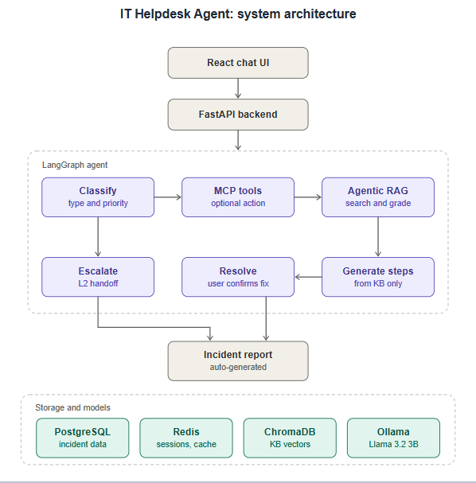
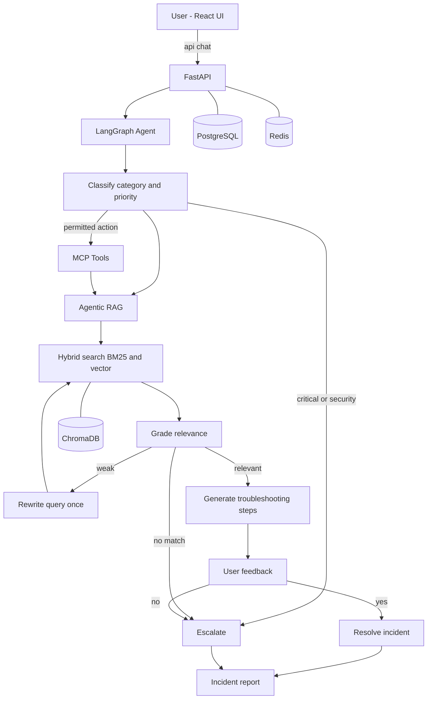

# Autonomous IT Helpdesk & Incident Resolution Agent

An agentic AI support platform that classifies IT issues, searches a knowledge base with Advanced and Agentic RAG, performs permitted actions through MCP tools, escalates unresolved incidents, keeps conversation and incident state, and generates incident reports automatically.

## Features

- Issue classification: category (network, software, access, hardware, security) and priority
- Hybrid retrieval: BM25 keyword search plus vector search with Reciprocal Rank Fusion
- Agentic RAG: relevance grading and one automatic query rewrite before giving up
- LangGraph workflow with conditional routing and escalation
- MCP server exposing IT tools: reset password, unlock account, check service status, restart service, create ticket, escalate incident
- Incident and conversation state in PostgreSQL, session state and retrieval cache in Redis
- Automatic incident report for resolved and escalated incidents (HTML view, print to PDF)
- Fully local LLM using Ollama (Llama 3.2 3B), no API key needed

## Web Portal (React)

| Page | What it does |
|---|---|
| Support chat | Chat with the agent, 15 suggestion cards with category filters, live incident panel |
| Dashboard | Totals for resolved, escalated and open incidents, category bars, incident table with report links |
| Knowledge base | 13 IT articles with search and category filter, "Ask the agent" starts a chat |
| How it works | Agent flow and technology stack |

## Tech Stack

| Area | Technology |
|---|---|
| Backend | Python 3.12, FastAPI |
| Agent | LangGraph, LangChain |
| LLM and embeddings | Llama 3.2 3B and nomic-embed-text (Ollama) |
| Vector database | ChromaDB |
| Retrieval | BM25 (rank-bm25) + vector search, RRF fusion |
| Tools protocol | MCP (Model Context Protocol) |
| Databases | PostgreSQL 16, Redis 7 |
| Frontend | React (Vite) |
| Deployment | Docker, Docker Compose |

## Architecture





## Project Structure

```
it-helpdesk-agent/
├── app/
│   ├── main.py              FastAPI app and endpoints
│   ├── config.py            Settings from .env
│   ├── agent/               LangGraph state, nodes, graph
│   ├── rag/                 ingest.py (chunking, embeddings), retriever.py (hybrid, grader, rewrite)
│   ├── mcp_server/          tools.py and server.py (MCP server)
│   ├── db/                  SQLAlchemy models and session
│   └── services/            redis_state.py, report.py
├── data/kb/                 13 IT knowledge base articles (markdown)
├── frontend/                React (Vite) portal
├── docs/                    Architecture diagram and sample reports
├── Dockerfile
├── docker-compose.yml
├── requirements.txt
└── generate_kb.py           Creates the knowledge base files
```

## Setup

### Prerequisites

- Docker Desktop, Ollama, Node.js 18+
- Pull the models:

```bash
ollama pull llama3.2:3b
ollama pull nomic-embed-text
```

### Run the backend with Docker

```bash
docker compose build api
docker compose up -d
docker compose exec api python -m app.rag.ingest
```

API docs: http://localhost:8000/docs

### Run the frontend

```bash
cd frontend
npm install
npm run dev
```

Open http://localhost:5173

## API Endpoints

| Method | Endpoint | Purpose |
|---|---|---|
| POST | /api/chat | Send a message, returns reply, incident id, category, priority, status |
| GET | /api/incidents | List recent incidents |
| GET | /api/report/{id} | Incident report (markdown) |
| GET | /api/report/{id}/view | Incident report as a formatted page (print to PDF) |

## Demo Scenarios

1. VPN not connecting: troubleshooting steps, user confirms, incident resolved
2. Phishing link clicked: security category, critical priority, automatic escalation
3. Printer offline: restart print spooler action, user says not resolved, escalated to L2
4. Forgot password: reset password action, steps provided, resolved
5. Blue screen: high priority, steps provided, user says not resolved, escalated

## Notes

- IT tools are simulated for demo purposes. In production they would call real systems (Active Directory, ITSM tools).
- Report timestamps are in UTC.
- The small local model can be strict when grading retrieved documents, so the agent also uses category matching as a rule-based backup. Repeated steps in model output are removed automatically.

## Future Improvements

- Authentication and user profiles
- Real ITSM integration (ServiceNow, Jira Service Management)
- Streaming responses and multi-language support
- Evaluation set for retrieval and routing accuracy