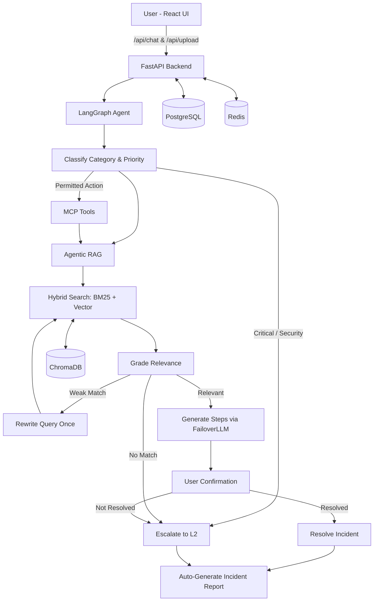

# Autonomous IT Helpdesk & Incident Resolution Agent

An agentic AI support platform that classifies IT issues, searches a knowledge base with Advanced and Agentic RAG, performs permitted actions through MCP tools, escalates unresolved incidents, maintains conversation and incident state, and generates incident reports automatically[cite: 20].

---

## Key Features

- **Multi-LLM Automatic Failover (`FailoverLLM`):** Seamless automatic fallback across **Google Gemini (`gemini-2.5-flash`)** → **Groq (`openai/gpt-oss-120b`)** → **Local Ollama (`llama3.2:3b`)** so the helpdesk remains available even during API rate limits or outages[cite: 1, 20].
- **Issue Classification:** Automatically detects category (`network`, `software`, `access`, `hardware`, `security`) and priority (`low`, `medium`, `high`, `critical`) using rule-based keyword matching with LLM backup[cite: 20, 22].
- **Hybrid Retrieval:** Combines **BM25** keyword search and **ChromaDB** vector search using **Reciprocal Rank Fusion (RRF)**[cite: 20, 21].
- **Agentic RAG:** Grades retrieved document relevance and performs an automatic query rewrite before escalating[cite: 20, 22].
- **LangGraph Workflow:** Stateful agent orchestration with conditional routing, self-service resolution, and L2 escalation[cite: 20, 22].
- **MCP Tool Execution:** Model Context Protocol server exposing IT tools (`reset_password`, `unlock_account`, `check_service_status`, `restart_service`, `create_ticket`, `escalate_incident`)[cite: 20, 21].
- **Multimodal & Voice Support:** Attach or paste screenshots and log files (`.png`, `.jpg`, `.webp`, `.txt`, `.log`, `.csv`, `.json`, `.md`) and use browser voice-to-text input[cite: 8].
- **Persistent State & Reports:** Incident and conversation history stored in **PostgreSQL**, session state and retrieval cache in **Redis**, and auto-generated **HTML/PDF incident reports** for resolved and escalated tickets[cite: 20, 22].

---

## Web Portal (React + Vite)

| Page | Capabilities |
| :--- | :--- |
| **Support Chat** | Interactive chat with live LLM provider badge (*Powered by Gemini / Groq*), step-by-step agent progress tracker, 15 categorized quick-issue cards, screenshot/file drag-and-drop, voice input, one-click resolution confirmation (`Resolved` / `Not resolved`), confetti celebration, and live incident sidebar[cite: 6, 8, 20]. |
| **Dashboard** | Real-time KPI cards with count-up animations, resolution rate donut chart, category distribution bars, manual refresh with feedback, and full incident history table with report links[cite: 8, 14, 20]. |
| **Knowledge Base** | 13 curated IT troubleshooting articles with instant keyword search, category filter chips, and one-click *"Ask the agent"* launch[cite: 8, 19, 20]. |
| **How It Works** | Visual 5-stage agent pipeline breakdown and complete technology stack overview[cite: 8, 20]. |

---

## Tech Stack

| Area | Technology |
| :--- | :--- |
| **Backend** | Python 3.12, FastAPI[cite: 21] |
| **Agent Orchestration** | LangGraph, LangChain[cite: 21] |
| **LLM Providers** | Google Gemini (`gemini-2.5-flash`), Groq (`openai/gpt-oss-120b`), Ollama (`llama3.2:3b`)[cite: 1, 21] |
| **Embeddings & Vector DB** | `nomic-embed-text` (Ollama), ChromaDB[cite: 21] |
| **Retrieval** | Hybrid BM25 (`rank-bm25`) + Vector Search with RRF Fusion[cite: 21] |
| **Tools Protocol** | MCP (Model Context Protocol)[cite: 21] |
| **Databases** | PostgreSQL 16, Redis 7[cite: 21] |
| **Frontend** | React (Vite), Custom CSS Glassmorphism & Animations[cite: 7, 21] |
| **Deployment** | Docker, Docker Compose[cite: 21] |

---

## Architecture




---

## Project Structure

```text
it-helpdesk-agent/
├── app/
│   ├── main.py             # FastAPI app, chat, upload, info & report endpoints
│   ├── config.py           # Environment configuration (.env)
│   ├── llm.py              # Multi-provider FailoverLLM (Gemini -> Groq -> Ollama)
│   ├── agent/              # LangGraph state, nodes, and conditional graph
│   ├── rag/                # ingest.py (chunking/embeddings) & retriever.py (hybrid + grading)
│   ├── mcp_server/         # tools.py and server.py (MCP IT tools)
│   ├── db/                 # SQLAlchemy models and database session
│   └── services/           # redis_state.py and report.py
├── data/kb/                # 13 IT knowledge base markdown articles
├── frontend/               # React (Vite) web application
│   └── src/
│       ├── App.jsx         # Chat, Dashboard, Knowledge Base & How It Works views
│       └── App.css         # Responsive grid, animated background & glassmorphism styles
├── docs/                   # Architecture diagrams and sample incident reports
├── Dockerfile
├── docker-compose.yml
├── requirements.txt
└── generate_kb.py          # Knowledge base generator script
```

---

## Setup & Installation

### 1. Prerequisites
- **Docker Desktop**[cite: 23]
- **Node.js 18+**[cite: 23]
- **API Keys** for [Google AI Studio (Gemini)](https://aistudio.google.com/) and/or [Groq Console](https://console.groq.com/)[cite: 2]
- *(Optional for local fallback)* **Ollama** with models pulled[cite: 23]:
  ```bash
  ollama pull llama3.2:3b
  ollama pull nomic-embed-text
  ```

### 2. Configure Environment Variables
Copy `.env.example` to `.env` and configure your API keys and models:

```env
GEMINI_API_KEY=your_gemini_api_key
GEMINI_MODEL=gemini-2.5-flash

GROQ_API_KEY=your_groq_api_key
GROQ_MODEL=openai/gpt-oss-120b

OLLAMA_BASE_URL=[http://host.docker.internal:11434](http://host.docker.internal:11434)
OLLAMA_MODEL=llama3.2:3b
```

### 3. Start Backend Services with Docker
```bash
docker compose up -d --build
docker compose exec api python -m app.rag.ingest
```
- **API Swagger Docs:** `http://localhost:8000/docs`[cite: 23]

### 4. Start the React Frontend
```bash
cd frontend
npm install
npm run dev
```
- **Web App:** `http://localhost:5173`[cite: 24]

---

## API Endpoints

| Method | Endpoint | Purpose |
| :--- | :--- | :--- |
| `POST` | `/api/chat` | Process user message/attachment; returns reply, incident ID, category, priority & status[cite: 8, 24] |
| `POST` | `/api/upload` | Upload screenshot or log file and extract text/context for troubleshooting[cite: 8] |
| `GET` | `/api/info` | Check active LLM provider order and last used model[cite: 8] |
| `GET` | `/api/incidents` | List all recent incidents[cite: 24] |
| `GET` | `/api/report/{id}` | Retrieve raw incident report in Markdown[cite: 24] |
| `GET` | `/api/report/{id}/view` | View formatted HTML incident report (print-to-PDF ready)[cite: 24] |

---

## Demo Scenarios

1. **VPN Not Connecting:** Provides step-by-step troubleshooting; clicking **Resolved** closes the ticket and triggers confetti[cite: 8, 24].
2. **Phishing Link Clicked:** Classified as `security` with `critical` priority and immediately escalated to L2[cite: 24].
3. **Printer Offline:** Executes `restart_service` MCP tool, provides steps, and escalates to L2 if marked **Not resolved**[cite: 8, 24].
4. **Forgot Password:** Triggers `reset_password` MCP action and guides user through recovery[cite: 24].
5. **Screenshot / Log Analysis:** Attach an error screenshot or `.log` file to auto-diagnose the issue[cite: 8].

---

## Developer Utilities (Reset Database)

To clear all test incidents and reset incident IDs back to `#1`:

```powershell
docker compose exec api python -c "from sqlalchemy import create_engine, text; from app.config import settings; conn = create_engine(settings.DATABASE_URL).connect(); conn.execute(text('TRUNCATE TABLE incidents RESTART IDENTITY CASCADE')); conn.commit(); conn.close(); print('CLEARED!')"
docker compose exec redis redis-cli FLUSHALL
```

---

## Notes & Future Improvements

- **Notes:** IT tools are simulated for demo purposes; report timestamps are stored in UTC; rule-based category matching acts as a backup for strict document relevance grading[cite: 24].
- **Future Improvements:** Role-based authentication and user profiles, live ITSM integration (ServiceNow / Jira Service Management), token-by-token streaming responses, multi-language support, and automated RAGAS evaluation for retrieval and routing accuracy[cite: 24, 25].